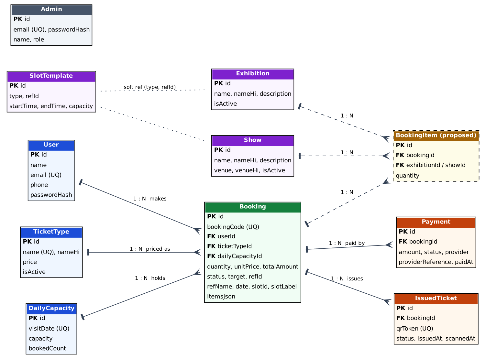
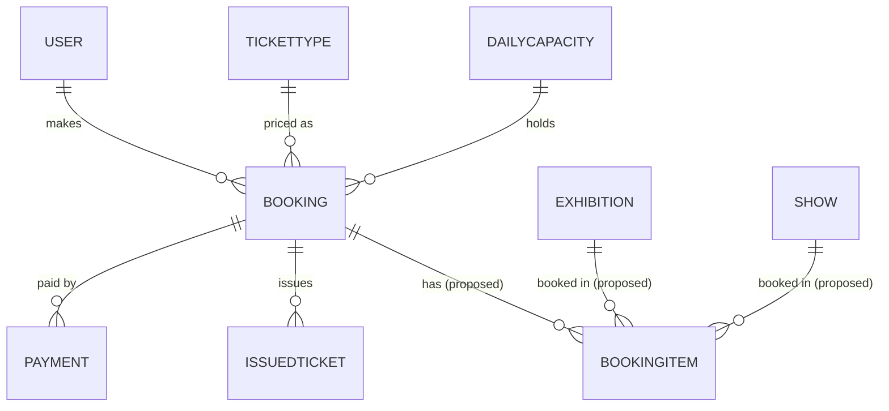

# 2. ER Diagram and Data Model (PostgreSQL)

Source: `evidence/er_diagram.dot` (Graphviz). Solid lines are enforced foreign keys; dashed items are the optional `BookingItem` extension; dotted lines are un-enforced "soft" references.

## Entities, attributes and keys
| Entity | Primary key | Foreign keys | Other key attributes |
|---|---|---|---|
| Admin | id | – | email (UQ), passwordHash, name, role |
| User | id | – | name, email (UQ), phone, passwordHash |
| TicketType | id | – | name (UQ), nameHi, price, isActive |
| Exhibition | id | – | name, nameHi, description, isActive |
| Show | id | – | name, nameHi, description, venue, isActive |
| SlotTemplate | id | – (soft: type + refId) | startTime, endTime, capacity |
| DailyCapacity | id | – | visitDate (UQ), capacity, bookedCount |
| Booking | id | userId → User, ticketTypeId → TicketType, dailyCapacityId → DailyCapacity | bookingCode (UQ), quantity, unitPrice, totalAmount, status, target, refId |
| Payment | id | bookingId → Booking | amount, status, provider, providerReference |
| IssuedTicket | id | bookingId → Booking | qrToken (UQ), status, issuedAt, scannedAt |

## Relationships
| Relationship | Cardinality | Business meaning |
|---|---|---|
| User – Booking | **1 : N** | A visitor can make many bookings; each booking belongs to one visitor |
| TicketType – Booking | **1 : N** | A ticket category (Adult, Child...) is used by many bookings |
| DailyCapacity – Booking | **1 : N** | One date row holds many bookings and tracks seats used |
| Booking – Payment | **1 : N** | A booking can have several payment attempts (failed, then success; refund) |
| Booking – IssuedTicket | **1 : N** | One QR ticket is issued per visitor in the booking |
| Booking – Exhibition / Show | **M : N** (conceptual) | A booking can cover several attractions and an attraction appears in many bookings. Today this is stored loosely in `target`, `refId`, `itemsJson`. The proposed **BookingItem** junction table (`sql/extension_booking_item.sql`) makes it a real many-to-many |
| SlotTemplate – Exhibition / Show | soft reference | `type` + `refId` point to an exhibition or show without a foreign key |
| Admin | standalone | Authentication entity, no relationship to bookings |

**One-to-one:** the current schema has no strict 1:1 relationship. The assignment asks for 1:1 only "wherever applicable"; if your evaluator asks, explain that each booking-to-payment relationship is 1:N because payments can be retried, and that a 1:1 would be wrong here.

## Mermaid version (renders on GitHub)

