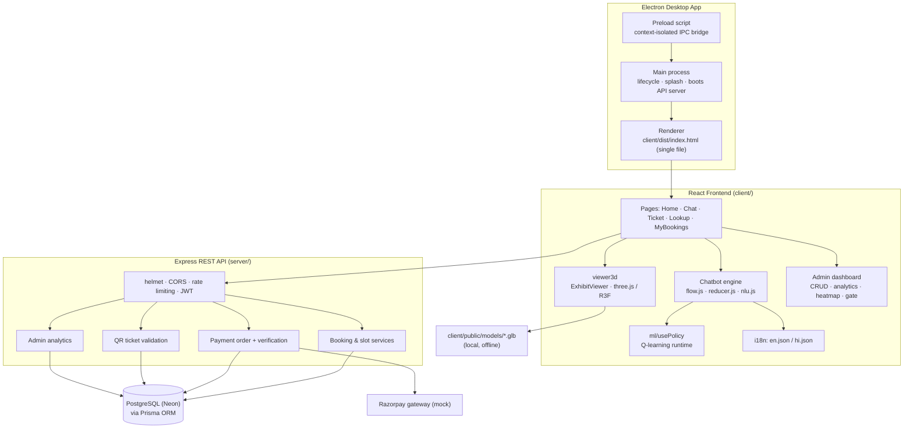
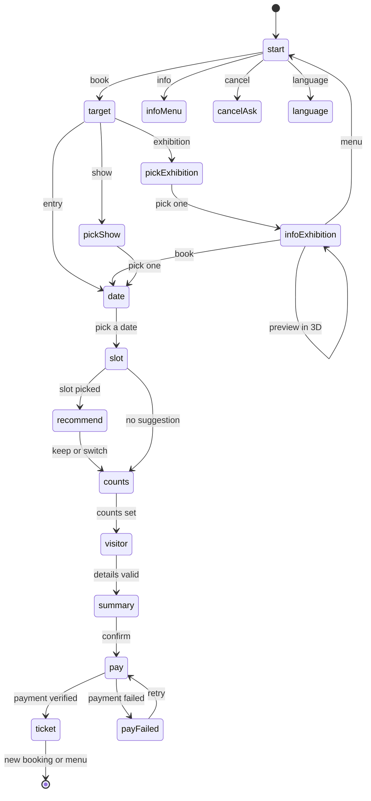
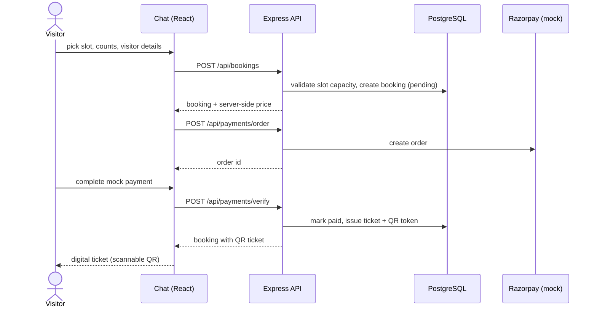
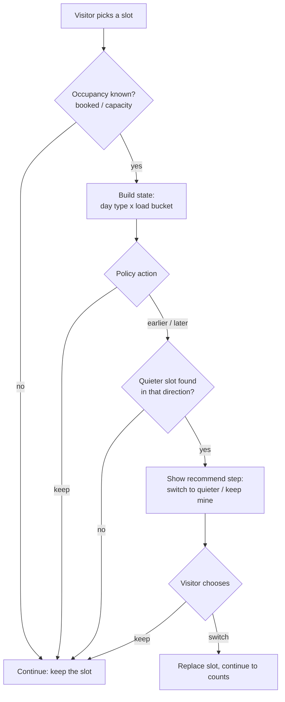
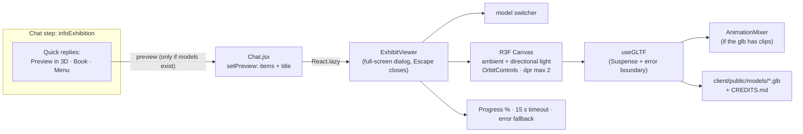
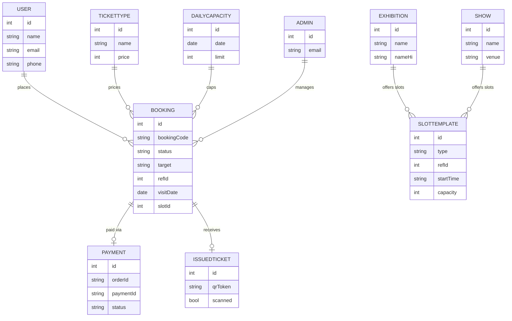

# 🏛️ MuseumX – Smart Museum Ticket Booking System

**An intelligent, multilingual chatbot-based museum ticket booking and management platform.**

MuseumX is a desktop-based museum management and ticket booking application designed to simplify the visitor experience through a conversational chatbot, 3D exhibit previews, a Q-learning slot recommender, online payments, digital ticketing and centralized administration.

The platform aims to eliminate the limitations of traditional manual ticket booking systems by providing a faster, more accessible and efficient digital solution.

---

## 📌 Problem Statement

Traditional museum ticket booking systems often involve long queues, manual record management, booking errors and inefficient handling of visitors during peak hours.

These limitations negatively affect visitor satisfaction and create additional operational challenges for museum administrators.

MuseumX addresses these problems through an integrated digital ticketing platform that automates the booking process and provides better management of museum operations.

## 🎯 Project Objectives

- Eliminate long queues through online ticket booking.
- Provide an interactive multilingual chatbot (English + Hindi).
- Automate ticket reservations and payment processing.
- Support bookings for museum entry, exhibitions and special shows.
- Generate digital tickets with QR codes.
- Reduce manual errors and duplicate bookings.
- Let visitors preview exhibits in interactive 3D before booking.
- Recommend quieter time slots with a trained Q-learning policy.
- Provide administrators with meaningful booking and revenue analytics.

---

## ✨ Key Features

### 1. Conversational Chatbot
- Step-based chatbot engine (`flow.js` + `reducer.js`) with quick replies and free typing.
- NLU helpers for dates, counts, visitor details, slot matching and global commands.
- Interactive ticket booking through conversations.
- Full English and Hindi support (393 i18n keys, parity-checked by a script).
- Information about exhibitions, shows and museum timings.
- Booking assistance and cancellation support.
- Sign-in required before booking; the visitor profile auto-fills from the account.

### 2. Ticket Booking System
- General museum entry bookings.
- Special exhibition bookings (with an exhibition info step in the chat).
- Scheduled show bookings.
- Date and time-slot selection with real-time availability.
- Sold-out slot detection and retry flows.
- Booking confirmation and cancellation (cancel by booking code + contact).

### 3. Online Payment Integration
- Razorpay-style mock order + verification flow (no real money moves).
- Backend-side payment verification.
- Payment status tracking and retry on failure.
- Automated booking confirmation after successful payment.

### 4. Digital QR Tickets
- Unique QR code generation per issued ticket.
- Digital ticket display and print-friendly page.
- QR-based gate validation (`Validate` admin page + `/api/tickets/validate`).
- Prevention of duplicate ticket usage.

### 5. Visitor Accounts
- Register and sign in (`UserAuthContext`, JWT-backed).
- Bookings saved to the visitor account (`My bookings` page).
- Booking lookup by code (`Lookup` page).

### 6. Admin Dashboard
- Manage ticket categories and pricing.
- Manage exhibitions and shows.
- Manage slot templates.
- Monitor visitor bookings and payment records.
- Gate validation of QR tickets.
- Booking, revenue and peak-hour analytics with charts.

---

## 🥽 AR/VR and AI Features

### Q-learning slot recommender

After a visitor picks a time slot, MuseumX checks how full that slot is and asks a
trained Q-learning policy whether to keep it or move the visitor to a quieter
slot. When a quieter slot exists in the recommended direction, the chatbot shows
two choices — **switch to the quieter slot** or **keep my slot** — in both English
and Hindi. If the policy is unavailable, the state is unknown, or no quieter slot
exists, the original selection is kept and the normal booking flow continues.

**Occupancy.** A slot's load is `booked ÷ capacity`. Missing, negative or
zero-capacity values are treated as unknown, never as a division by zero.

**State.** `day type × occupancy bucket`:

| Component | Values |
|---|---|
| Day type | `weekday`, `weekend`, `holiday` |
| Load bucket | `low` (< 0.50), `medium` (0.50 – 0.80), `high` (> 0.80) |

**Actions.** `keep`, `earlier`, `later`.

**Reward design.**

| Situation | Reward |
|---|---|
| Keep at low load | +1 |
| Keep at medium load | +0.2 |
| Keep at high load | −1 |
| Suggest at high load, alternative has lower load | +1 |
| Suggest at medium load, alternative has lower load | +0.5 |
| Suggest at medium load, alternative is not lower | −0.5 |
| Suggest at low load | −0.5 |
| Suggested alternative is also high load | −1 |
| No alternative slot in that direction | −0.2 |

Medium-load rewards are defined explicitly so training and runtime behaviour stay
consistent. Training uses tabular Q-learning with ε-greedy exploration
(ε decays from 1.0 to 0.05), learning rate `0.1`, discount factor `0.9`,
4000 episodes and a seeded simulation of visitor arrivals peaking at midday and
on weekends/holidays.

**Files.**

| File | Purpose |
|---|---|
| `client/src/ml/train.mjs` | Trains the agent and writes `qpolicy.json` |
| `client/src/ml/qpolicy.json` | Generated policy: best action and Q-values per state |
| `client/src/ml/usePolicy.js` | Runtime lookup, occupancy math, quieter-slot search and safe fallbacks |
| `client/src/ml/usePolicy.test.js` | Unit tests for the policy runtime |
| `client/src/chatbot/engine/reducer.js` | Runs the recommendation step after slot selection |
| `client/src/admin/PolicyHeatmap.jsx` | Admin heatmap of the learned policy (day types × load buckets) |

**Run the training script** (from the repository root):

```bash
node client/src/ml/train.mjs
```

The script validates that all nine states were sampled, checks the exported
actions and Q-values, and rewrites `client/src/ml/qpolicy.json`. The file is
included in the repository so the packaged Electron app can load the policy
without any network or CDN dependency.

### 3D exhibit preview (viewer3d)

Visitors can preview exhibits in 3D before booking. On the exhibition info step
of the chatbot, exhibitions that have models show a **Preview in 3D** quick reply
that opens a full-screen viewer over the chat. Exhibitions can have **several
models** — a ‹ › switcher (buttons or ← → arrow keys) cycles between them, with
the current model's name and credit line shown in the viewer. Models that ship
with animations (e.g. the rigged T-Rex skeleton) play their first clip on loop.

- Orbit rotation, limited zoom (1.5–6), panning disabled.
- Ambient + directional lighting; auto-rotate until the visitor interacts.
- Progress indicator while a model loads; timeout message after ~15 s.
- Error boundary + translated error message if a model fails — the chat keeps working.
- Closing the viewer (Escape or Close) returns to the same chat step with the
  booking state untouched.
- Engine: three.js via `@react-three/fiber` + `@react-three/drei`, lazily imported.
- Models: glb files under `client/public/models/`, all under 5 MB (compressed with
  gltf-transform); see `client/public/models/CREDITS.md` for authors and licences.
- Mapping: `client/src/viewer3d/models.js` maps exhibition ids to model lists;
  exhibitions without an entry simply show no preview option.
- Works offline in the packaged Electron app: relative asset paths, no CDN
  requests, plain lights instead of environment maps.
- Cardboard stereo mode is planned future scope (strings are already in place).

**Model roster.**

| Exhibition | Models |
|---|---|
| Invention | Antique Camera, Antique Gramophone |
| Human Biology | Human Heart, DNA Strand |
| Dinosaur Park | Indominus Rex (textured), T-Rex Skeleton (animated) |

### Course concepts

| Course concept | Project application |
|---|---|
| Q-learning | Learns a slot recommendation policy from simulated visitor demand |
| Reinforcement learning | State, action, reward and policy learning |
| Epsilon-greedy strategy | Balances exploration and exploitation during training |
| Policy visualization | Admin heatmap showing the learned action per state |
| Materials / lights | PBR materials and scene lighting in the 3D viewer |
| Blender asset pipeline | Model cleanup, material rebuild and glb export |
| Mobile VR / Cardboard | Stereo mode planned as future scope |

### AR/VR status

This build of MuseumX includes the interactive 3D exhibit preview described
above, opened from the chatbot. A Google Cardboard / stereo VR mode is not
implemented yet and remains future scope.

---

## 🛠️ Technology Stack

| Technology | Purpose |
|---|---|
| Electron + electron-builder | Desktop application framework and packaging |
| React 18 + React Router | Frontend and routing |
| three.js + @react-three/fiber + @react-three/drei | 3D exhibit preview |
| i18next + react-i18next | English/Hindi internationalisation |
| Recharts | Analytics visualization |
| Vitest | Frontend unit tests |
| Node.js + Express.js | Backend REST API |
| PostgreSQL (Neon) + Prisma ORM | Database and data access |
| JSON Web Tokens | Visitor and admin sessions |
| helmet + express-rate-limit + CORS | API hardening |
| Razorpay (mock) | Payment gateway flow |
| QR Code (qrcode.react) | Digital ticket generation |
| gltf-transform + Blender | 3D asset preparation and compression |
| concurrently + wait-on | Dev/startup orchestration |

---

## 🧭 Application Routes (client)

Hash-based routing (`HashRouter`), so every URL works from `file://` in Electron.

| Route | Page | Access |
|---|---|---|
| `/` | Home / landing | Public |
| `/chat` | Chatbot (booking, info, cancel, 3D preview) | Public (booking needs sign-in) |
| `/login` | Visitor sign in / register | Public |
| `/lookup` | Find a booking by code | Public |
| `/ticket/:bookingId` | Digital ticket with QR | Ticket holder |
| `/my-bookings` | Visitor's bookings | Signed-in visitors |
| `/admin/login` | Admin sign in | Public |
| `/admin` | Dashboard | Admin |
| `/admin/bookings` | All bookings | Admin |
| `/admin/payments` | Payment records | Admin |
| `/admin/exhibitions` | Manage exhibitions | Admin |
| `/admin/shows` | Manage shows | Admin |
| `/admin/slots` | Manage slot templates | Admin |
| `/admin/pricing` | Manage ticket types | Admin |
| `/admin/validate` | QR gate validation | Admin |

## 🔌 API Endpoints (server)

| Method | Endpoint | Purpose |
|---|---|---|
| GET | `/api/health` | Health check (also used by `wait-on`) |
| GET | `/api/ticket-types` | Ticket categories and prices |
| GET | `/api/exhibitions` | Exhibitions |
| GET | `/api/shows` | Shows |
| GET | `/api/slots` | Slot availability by date/type/refId |
| POST | `/api/bookings` | Create a pending booking (server-side pricing) |
| GET | `/api/bookings/:idOrCode` | Booking lookup by id or code |
| POST | `/api/bookings/:idOrCode/cancel` | Cancel a booking (code + contact) |
| POST | `/api/payments/order` | Create a payment order |
| POST | `/api/payments/verify` | Verify payment and issue the ticket |
| POST | `/api/user/register` | Visitor registration |
| POST | `/api/user/login` | Visitor sign in |
| GET | `/api/user/me` | Current visitor profile |
| GET | `/api/user/bookings` | Signed-in visitor's bookings |
| POST | `/api/admin/login` | Admin sign in |
| GET/POST/DELETE | `/api/admin/ticket-types` | Manage ticket types |
| GET/POST/DELETE | `/api/admin/exhibitions` | Manage exhibitions |
| GET/POST/DELETE | `/api/admin/shows` | Manage shows |
| GET/POST/DELETE | `/api/admin/slots` | Manage slot templates |
| GET | `/api/admin/bookings` | All bookings |
| GET | `/api/admin/payments` | All payments |
| GET | `/api/admin/analytics/summary` | Totals and revenue |
| GET | `/api/admin/analytics/popular` | Popular exhibitions/shows |
| GET | `/api/admin/analytics/bookings-by-day` | Bookings per day |
| GET | `/api/admin/analytics/peak-hours` | Peak visiting hours |
| POST | `/api/tickets/validate` | Gate validation of a QR token |

Admin routes require a JWT; visitor booking routes require a signed-in visitor.

## 📜 npm Scripts (root)

| Script | What it does |
|---|---|
| `npm run install:all` | Install root, server and client dependencies |
| `npm run dev` | API + Vite dev server + Electron, wired together |
| `npm run build:client` | Production build of the client (single-file `dist/index.html`) |
| `npm start` | Build the client, run the API and the packaged Electron app |
| `npm run dist:dmg` | Build the client and package a macOS .dmg via electron-builder |

Client-only: `npm run test --prefix client` (Vitest), `npm run check:i18n --prefix client` (EN/HI key parity).

## 🏗️ System Architecture

MuseumX follows a modular architecture that separates the desktop application, frontend, backend and database.



### Electron Architecture

Electron provides the desktop environment and secure communication between the renderer and main processes using IPC. The packaged app starts the API server, waits for `/api/health`, then loads the built single-file client from `client/dist/index.html`. See `electron/HOW TO OPEN.txt` for the packaged-build notes.

### Backend Architecture

Express (`server/src/index.js`) handles API requests, booking operations, payment verification, authentication, rate limiting and database interactions. `auth.js` issues and verifies JWTs; `db.js` owns the Prisma/Neon connection; `chatbot.js` holds chatbot-facing data helpers.

### Database Architecture

PostgreSQL (Neon) stores visitors, administrators, ticket types, exhibitions, shows, slot templates, daily capacities, bookings, payments and issued tickets.

### Chatbot booking flow

The chatbot is a step machine: `flow.js` defines the steps, `reducer.js` applies picks and loads data. The 3D preview hangs off the exhibition info step without touching booking state.



### Booking and payment sequence



### Q-learning recommendation flow



### 3D exhibit preview architecture



### Database ER diagram



---

## 📂 Project Structure

```text
MuseumX/
│
├── electron/
│   ├── main.cjs              # app lifecycle, splash, server boot, prod loading
│   ├── preload.cjs           # IPC bridge (context isolation)
│   └── HOW TO OPEN.txt       # packaged-build notes
│
├── client/
│   ├── public/models/        # glb exhibits + CREDITS.md
│   ├── scripts/check-i18n.mjs
│   └── src/
│       ├── api/              # endpoints.js, client.js, mockApi.js
│       ├── chatbot/
│       │   ├── components/   # QuickReplies, DateControl, PaymentSheet, …
│       │   ├── engine/       # flow.js, reducer.js, nlu.js (+ tests)
│       │   └── useChat.js
│       ├── viewer3d/         # ExhibitViewer, ModelErrorBoundary, models.js (+ tests)
│       ├── ml/               # train.mjs, qpolicy.json, usePolicy.js (+ tests)
│       ├── admin/            # dashboard, CRUD pages, Validate, PolicyHeatmap
│       ├── user/             # UserAuthContext
│       ├── pages/            # Home, Chat, Ticket, Lookup, MyBookings, …
│       ├── components/       # shared UI (TicketCard, Loader, …)
│       ├── hooks/            # useApiData
│       ├── i18n/             # en.json, hi.json
│       ├── lib/              # format helpers
│       ├── App.jsx           # routes
│       └── style.css
│
├── server/
│   ├── prisma/               # schema.prisma, migrations, seed.js
│   └── src/
│       ├── index.js          # Express app, all routes, rate limiting
│       ├── auth.js           # JWT signing/verification
│       ├── chatbot.js        # chatbot data helpers
│       └── db.js             # Prisma/Neon client
│
├── DE/                       # database engineering docs, SQL, evidence
│   ├── docs/                 # 10 numbered design documents
│   ├── sql/                  # schema, queries, integrity tests
│   ├── backend_integration/  # standalone integration demo
│   └── evidence/             # ER diagram, query outputs, logs
│
├── package.json              # root scripts, electron-builder config
└── README.md
```

## ⚙️ Installation and Setup

### Prerequisites

- Node.js 18+
- npm
- A PostgreSQL database (Neon works out of the box)
- Git

### 1. Clone and install

```bash
git clone https://github.com/akshatjoddd/asd_major_project.git
cd asd_major_project
npm run install:all
```

### 2. Configure environment variables

Create `server/.env`:

```env
DATABASE_URL="your_database_connection_url"
DIRECT_URL="your_direct_database_connection_url"
PORT=4000
JWT_SECRET="any-long-random-string"
```

`JWT_SECRET` is required — the server refuses to start without it. Never commit real credentials.

### 3. Set up the database

```bash
cd server
npx prisma generate
npx prisma db push     # or: npx prisma migrate dev
node prisma/seed.js    # seeds ticket types, exhibitions, shows, slots, admin
```

### 4. Run it

```bash
npm run dev            # API + web + Electron in dev mode
# or without Electron:
npm run dev --prefix server   # API on :4000
npm run dev --prefix client   # web on :5173
```

Open http://localhost:5173 (dev) — the app routes are hash-based (`/#/chat`, `/#/admin`…).

### 5. Package the desktop app

```bash
npm run dist:dmg       # builds the client and a macOS .dmg into release/
```

## 🧪 Testing

```bash
npm run test --prefix client        # 58 unit tests (chatbot engine, ml policy, models map, mock booking lifecycle)
npm run check:i18n --prefix client  # EN/HI key parity + placeholder checks
```

The chatbot reducer tests cover the full booking flow, the slot recommender, the
exhibition info step and 3D preview option visibility. The mock API tests run a
complete booking lifecycle (create → pay → ticket → cancel) without a database.

## 🔐 Security Considerations

- Electron context isolation and disabled Node.js integration in the renderer.
- Secure IPC communication through preload scripts.
- JWT sessions for visitors and admins; the server refuses to start without `JWT_SECRET`.
- Helmet security headers and a tight CORS allow-list.
- Rate limiting on auth endpoints (10 requests / 15 min per IP).
- Hashed administrator passwords.
- Backend-side payment verification; the client never decides payment success.
- Booking validation, sold-out slot enforcement and duplicate-entry prevention.
- 3D assets and fonts served locally — no third-party CDN calls.

## 🗄️ Database Modules

The database consists of the following 10 entities (defined in `schema.prisma`):

| Entity | Description |
|---|---|
| Admin | Administrator accounts |
| User | Museum visitors |
| TicketType | Ticket categories and pricing |
| Exhibition | Museum exhibitions |
| Show | Special museum shows |
| SlotTemplate | Scheduled entry and show timing templates |
| DailyCapacity | Daily visitor capacity tracking and limits |
| Booking | Visitor reservations |
| Payment | Transaction and payment verification records |
| IssuedTicket | Digital tickets with unique QR tokens and gate scan tracking |

## 👥 Team Members and Responsibilities

| Member | Responsibilities |
|---|---|
| Akshat Rane | Electron development, database architecture, Prisma schema and desktop integration |
| Arnav | Backend development, APIs, booking logic and payment integration |
| Pallav | React frontend, chatbot interface, 3D exhibit viewer and admin dashboard |

## 🚀 Future Scope

- Google Cardboard stereo VR mode (viewer strings already in place).
- Support for additional Indian languages.
- Advanced visitor behaviour analytics.
- Personalized exhibition recommendations.
- Integration with museum membership systems.
- Automated email and SMS notifications.
- Multi-museum support.
- Advanced reporting and operational forecasting.

## 📊 Project Status

**Feature-complete for the current scope, under active polish.**

Implemented: chatbot booking flow (entry/exhibition/show), visitor accounts,
mock payment + QR tickets, cancellation, admin dashboard with CRUD, analytics
and gate validation, Q-learning slot recommender with admin heatmap, 3D exhibit
preview with six models across three exhibitions, EN/HI i18n, Electron
packaging, database engineering documentation.

## 🏛️ Project Context

**Domain:** Travel & Tourism  
**Category:** Software  
**Year:** 2024  
**Organization:** Ministry of Culture  
**Department:** National Council of Science Museums

## 📄 License

This project is developed for educational and demonstration purposes. Licensing and third-party technology terms apply to their respective components. 3D model licences are recorded in `client/public/models/CREDITS.md`.

---

**MuseumX – Making Museum Visits Smarter, Simpler and More Accessible.**
